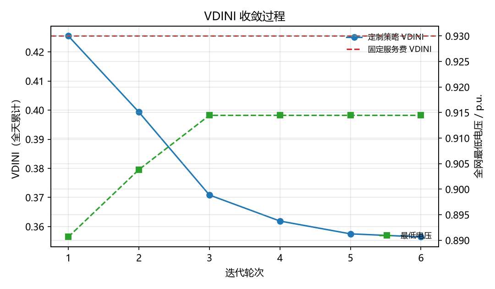
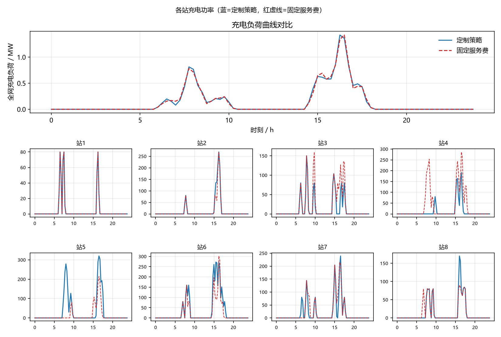
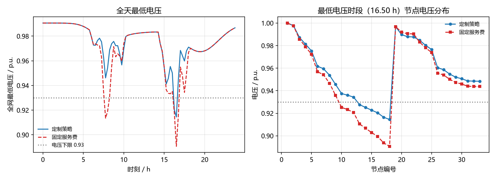

# 面向智慧城市的快充负荷服务费定制策略仿真

复现徐诗鸿等《面向智慧城市的快充负荷充电服务费制定策略》
（中国电机工程学报 2020, 40(10): 3187-3200，DOI 10.13334/j.0258-8013.pcsee.190112）
的四模块闭环仿真：**路网交通 -> 充电负荷 -> 配电网潮流 -> 服务费动态调整**。

核心思路：通过分站差异化调整快充站的服务费，把电动汽车从电压薄弱的节点
引导到电压健康的节点充电，在**不改变用户总充电费用**的前提下改善配电网电压质量。

## 四个模块

1. **路网交通仿真**：方格路网内生成电动汽车出行需求（出发地、目的地、出发时刻、出行链），
   当剩余 SOC 低于阈值或不足以完成后续行程时产生快充需求，按综合成本（服务费 + 绕行时间 +
   绕行耗电）以 Logit 概率选择充电站。
2. **充电负荷预测**：按站点、按时段（96 个 15 分钟）聚合充电功率，含每站桩数约束与
   先到先服务排队，等待时长反馈到下一轮选站。
3. **配电网潮流计算**：IEEE 33 节点配电网（pandapower），逐时段潮流求节点电压，
   计算 VDINI = Σ(节点关键度 × 电压偏差)，电压带外的偏差乘惩罚系数。
4. **服务费动态调整**：按电压判据对各站上调/下调一个档位，再整体平移使加权平均服务费
   回到初始值（总费用不变约束），迭代至收敛。

## 运行

```bash
pip install -r requirements.txt
python -m fcs_sim.webgui        # 图形界面（浏览器/应用窗口）
python -m fcs_sim.main          # 命令行全量仿真
```

Windows 下也可以直接双击 `run_gui.bat` / `run_sim.bat`。

常用命令行参数：

```text
--n-ev 5000           电动汽车数量
--public-share 0.10   公共快充比例
--battery 24          电池容量 kWh
--soc-trigger 0.25    触发 SOC 阈值
--pile-power 80       单桩功率 kW
--piles 4             每站桩数
--fee-min 1.4         服务费下限
--fee-max 1.6         服务费上限
--base-scale 0.45     基础负荷缩放
--v-lower 0.93        电压下限
--max-iter 8          最大迭代轮数
--seed 20261014       随机种子
```

全部参数集中在 `fcs_sim/config.py` 的 `Config` 数据类中。

## 结果对比

三组策略：**定制服务费**（分站按电压差异化调整）、**固定服务费**（不调整）、
**全网统一调整**（所有站同档升降，作为对照）。三组充电量一致，比较公平。

| 指标 | 定制策略 | 固定服务费 | 全网统一调整 |
| --- | --- | --- | --- |
| VDINI 全天累计 | 0.3633 | 0.4351 | 0.4351 |
| 全网最低电压 / p.u. | 0.9145 | 0.8907 | 0.8907 |
| 电压越限时段数 | 2 | 5 | 5 |

结论与论文一致：分站定制服务费把充电负荷从电压薄弱节点引导到健康节点，
在用户总费用不变的前提下降低 VDINI、抬升最低电压、减少越限；全网统一调价
缺乏空间分辨能力，基本无效。

示例输出（`docs/sample_results/`）：





## 目录结构

```text
fcs_sim/
  config.py        参数配置
  road_network.py  方格路网与最短路
  traffic_sim.py   模块一：出行需求与选站
  charging_load.py 模块二：充电负荷与排队
  grid_model.py    模块三：IEEE 33 潮流与 VDINI
  pricing.py       模块四：服务费调整
  main.py          主循环（四模块串联）
  report.py        结果输出（CSV + 图）
  webgui.py        网页界面
  appgui.py        桌面窗口界面
  __init__.py      包初始化
launcher.py        打包入口
docs/sample_results/  示例输出
```

## 与论文原文的差异

1. 论文算例是 54 节点配电网 + 25 节点路网 + 5 座快充站（各 50 桩 × 80 kW）+ 100 辆 EV；
   本工程按 IEEE 33 配电网 + 8×8 路网 + 8 座站 + 5000 辆 EV 的规模实现，
   充电行为、选站模型、VDINI、服务费调整与总费用不变约束沿用论文。
2. 论文正文写"初始服务费 2 元/(kW·h)"，按其"总充电费用不变"约束验算应为
   2 角/(kW·h)（0.2 元/(kW·h)）；本工程按 [1.4, 1.6] 元/kWh 的区间实现。
3. 论文称 VDINI 由 27.5524 降至 15.8329（降 42.5%）；按其附录表 A2/A3 的节点电压
   以度数加权复算，降幅仅约 1%，且附录存在节点 31 负荷与表 2 桩数增量对不上、
   缺少节点 44 等问题。绝对数值还依赖文献[21]的节点重要度定义（论文未给出），
   因此本工程按公式实现并报告自身结果。

## 依赖

`numpy`、`pandas`、`matplotlib`、`pandapower`（见 `requirements.txt`）。
